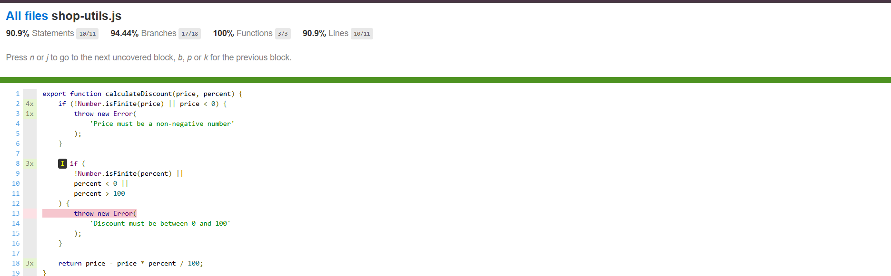

# Лабораторна робота №3

## Модульне тестування програмного коду за допомогою Vitest

**Виконав: Капінос Альона Олександрівна**  
**Група: 6.1213-2пі**  
**Дата: 24.10.2026**

## Test Object

`src/shop-utils.js`

## Функції

- `calculateDiscount()`
- `validateQuantity()`
- `getShippingCost()`

## Test Design

### calculateDiscount

## Test Condition:

- TCND-01 - підрахунок фінальної ціни з валідним відцотком знижки та валідною ціною, що знаходяться всредині діапазону;

Test Data: 

- price = 100
- percent = 10

- TCND-02 - підрахунок фінальної ціни з валідною ціною та знижкою, що знаходиться на нижній межі;

Test Data: 

- price = 100
- percent = 0 

- TCND-03 - підрахунок фінальної ціни з валідною ціною та знижкою, що знаходиться на нижній межі;

Test Data: 

- price = 100
- percent = 100 

- TCND-04 - відхилення значення ціни та вивід валідаційного повідомлення при негативній ціні

Test Data: 

- price = -10
- percent = 10

### validateQuantity

## Equivalence partitions

- Клас 1: Кількість < 1 | false
- Клас 2: Кількість з діапазону - ціле число від 1 до 10 | true
- Клас 3: Кількість > 10 | false
- Клас 4: Кількість не є цілим числом | false

## Boundary values

Для діапазону слід визначити граничні значення. Це 3 значення на кожну межу. 

- З верхньої межі: 
Кількість = 0 | false
Кількість = 1 | true
Кількість = 2 | true

- З нижньої межі: 
Кількість = 9 | true
Кількість = 10 | true
Кількість = 11 | false

### getShippingCost

## Гілки, що було перевірено

- Безкоштовна доставка:
Test Data:
total =  1000

Перший if хибний, другий (total >= 1000) істинний, повертається 0

- Платна доставка:

Test Data:
total =  999

Обидва if хибні, виконується фінальний return 100

- Помилка при від'ємному значенні

Test Data:
total =  -1 

Умова total < 0 істинна, кидається помилка

## Результати тестування

| Група тестів | Кількість | Result |
|---|---:|---|
| calculateDiscount | 4 | Passed |
| validateQuantity | 7 | Passed |
| getShippingCost | 3 | Passed |

Всі 15 тестів було пройдено

## Coverage

| Metric | Result |
|---|---:|
| Statements | 90.9 % |
| Branches | 94.44 % |
| Functions | 100 % |
| Lines | 90.9 % |

Покриття тестами не повне. Було перевірено HTML report , що відображає частини виконаного та невиконаного коду: 

Для 100 % до группи тестів calculateDiscount було додано тест за такою умовою:

- TCND-05 - відхилення значення знижки та вивід валідаційного повідомлення при негативній знижці

Test Data: 

- price = 100
- percent = -10

Тест було пройдено, фінальне значення покриття:

| Metric | Result |
|---|---:|
| Statements | 100 % |
| Branches | 100 % |
| Functions | 100 % |
| Lines | 100 % |

## Висновок

Було проведено автоматизоване тестування 3 юнітів - функцій calculateDiscount, validateQuantity, getShippingCost за допомогою Vitest. Використано техніку класів еквівалентності та граничних значень та створено загалом 15 тест-кейсів. Всі 15 тестів було успішно пройдено. 

Також було проведено аналіз покриття тестами та сформовано Coverage Report, в результаті чого було знайдено, що покриття тестами не повне. Тому було додано додатковий тест у группу calculateDiscount та досягнено 100% покриття. 