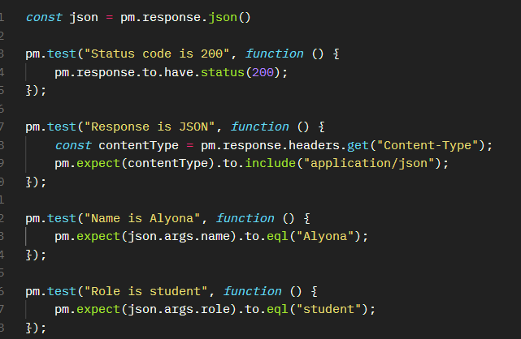
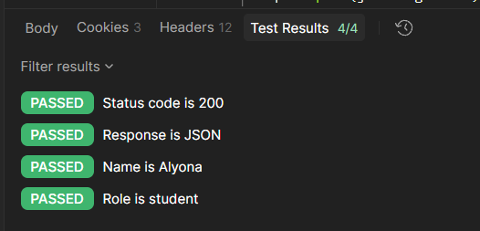
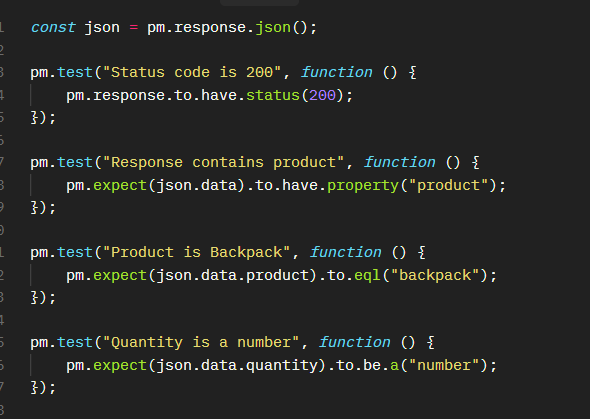
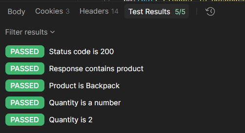
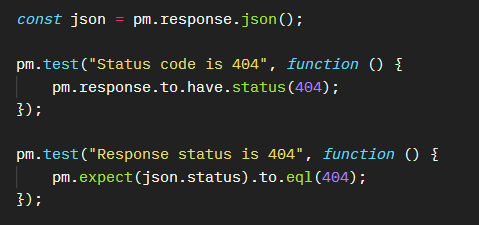
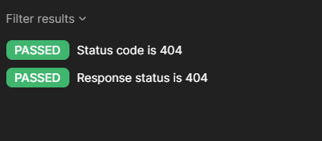

# Лабораторна робота №4

## Тестування HTTP API за допомогою Postman

**Виконала: Капінос Альона Олександрівна**  
**Група: 6.1213-2пі**  
**Дата: 24.10.2026**

## Test Object

Postman Echo. Base URL: `https://postman-echo.com`

## Collection

`Lab 4 - API Testing`. Collection Variable: `baseUrl =
https://postman-echo.com`

## 01 GET with Params

Request: {{baseUrl}}/get?name=Alyona&role=student

### Expected Result

- Status = 200
- Content-Type містить application/json
- args.name = "Alyona"
- args.role = "student"

### Actual Result

- Status = 200
- Content-Type містить application/json
- args.name = "Alyona"
- args.role = "student"

## Автоматизований тест 

## Status

Passed

## 02 POST Json

Request: {{baseUrl}}/post

Request Body: 

{
    "product": "backpack",
    "quantity": 2 
}

### Expected Result

- Status = 200
- Response містить відправлені дані:
● product = "Backpack"
● quantity = 2

### Actual Result

- Status = 200
- Response містить відправлені дані:
● product = "Backpack"
● quantity = 2

## Автоматизований тест 

## Status

Passed

## 03 Negative GET - 404

Request: {{baseUrl}}/status/404

### Expected Result

- Status = 404
- Body містить status = 404

### Actual Result

- Status = 404
- Body містить status = 404

## Автоматизований тест 

## Status

Passed

## Загальний результат

| Request | Tests | Passed | Failed |
| :--- | :--- | :--- | :--- |
| GET with Params | 4 | 4 | 0 |
| POST JSON | 5 | 5 | 5 |
| Negative - 404 | 2 | 2 | 0 |
| **Усього** | **11** | **11** | **0** |

## Висновок

Було створено та протестовано 3 HTTP-запити за допомогою Postman: GET із параметрами, POST із JSON Body та негативний тест із очікуваним статусом 404. Для кожного запиту було перевірено відповідність фактичного результату очікуваному та створено автоматизовані перевірки. Загалом було створено 11 тестів, усі з яких успішно пройдено.

Також було використано змінну колекції `baseUrl`, проаналізовано відповіді API та перевірено правильність статус-кодів і переданих даних. У результаті тестування всі перевірки отримали статус PASSED, тому потреби в оформленні баг-репорту немає. 
