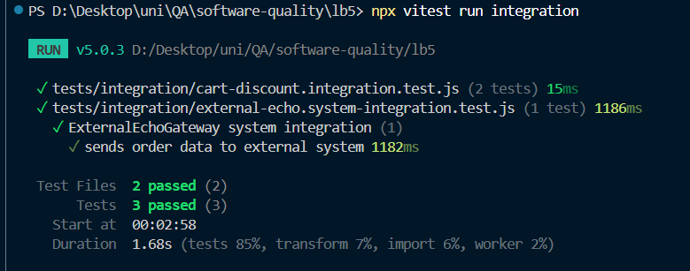

# Лабораторна робота №5

## Інтеграційне тестування компонентів та зовнішніх систем

**Виконала: Капінос Альона Олександрівна**  
**Група: 6.1213-2пі**  
**Дата: 23.11.2026**


## 1. Інтеграційне тестування компонентів

### 1.1. Тестований об'єкт

`CartService ↔ shop-utils`

### 1.2. Сценарій 1 — застосування знижки

**Вхідні дані:**

- перший товар: ціна `100`, кількість `1`;
- другий товар: ціна `200`, кількість `1`;
- розмір знижки: `10%`.

**Очікуваний результат:** `270`.  
**Фактичний результат:** `270`.  
**Результат:** `Passed`.

### 1.3. Сценарій 2 — передача помилки валідації

**Вхідні дані:**

- товар: ціна `100`, кількість `1`;
- розмір знижки: `110%`.


**Очікуваний результат:** помилка `Discount must be between 0 and 100`.  
**Фактичний результат:** помилка `Discount must be between 0 and 100`.
**Результат:** `Passed`.


## 2. Системне інтеграційне тестування

### 2.1. Тестований об'єкт

`ExternalEchoGateway ↔ Postman Echo`

### 2.2. Сценарій — передавання даних замовлення

**Вхідні дані:**

- `orderId = ORD-001`;
- `total = 270`.

**Очікувана відповідь:**

```json
{
  "orderId": "ORD-001",
  "total": 270
}
```

**Фактичний результат:** 

```json
{
  "orderId": "ORD-001",
  "total": 270
}
```

**Результат:** `Passed`.

## 3. Результати тестування

| Група тестів | Кількість тест-кейсів | Результат |
|---|---:|---|
| Unit-тести `shop-utils` | 15 | 15 Passed |
| Інтеграція `CartService + calculateDiscount` | 2 | 2 Passed |
| Система `ExternalEchoGateway ↔ Postman Echo` | 1 | 1 Passed |
| **Разом** | **18** | **18 Passed** |




## 4. Висновок

У ході лабораторної роботи було перевірено взаємодію компонента кошика `CartService` із функцією розрахунку знижки `calculateDiscount`, а також інтеграцію власного класу `ExternalEchoGateway` із зовнішньою системою Postman Echo.

Всі  тести успішно були пройдені. Інтеграційні тести підтвердили коректність передачі загальної вартості кошика та відсотка знижки, поширення помилки валідації й повернення очікуваних даних із зовнішнього сервісу.
